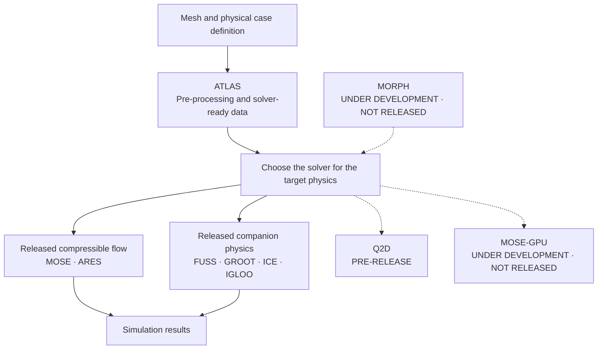

<p align="center">
  
</p>

<h1 align="center">OPEN HYDRA</h1>

<p align="center">
  <strong>Open, modular multi-physics CFD.</strong><br />
  From compressible flow and real-fluid thermodynamics to heat transfer, radiation, and dispersed phases.
</p>

<p align="center">
  <a href="https://github.com/open-hydra"></a>
  
  
  
</p>

<p align="center">
  <a href="#explore-the-suite">Explore the suite</a> ·
  <a href="#choose-your-solver">Choose a solver</a> ·
  <a href="#get-started">Get started</a> ·
  <a href="#contribute">Contribute</a>
</p>

---

<p align="center">
  
  <sub>Numerical flow-field visualisation · <a href="https://github.com/open-hydra/MOSE">MOSE</a></sub>
</p>

## Engineering the physics, not just the flow

Open Hydra is an ecosystem of open-source scientific solvers and workflow tools built around **multi-block numerical simulation**. Its projects address different parts of a multiphysics problem: preparing solver inputs, resolving compressible gas flows, and modelling the thermal, radiative, and particulate phenomena that interact with them.

The suite is **modular by design**. Each repository focuses on a specific job, with its own build instructions, documentation, and supported physics. Use the component that fits your problem, then combine tools where the relevant interfaces and coupling modes are supported.

## Explore the suite

The projects are grouped below by their current development status. **Pre-release and in-development projects are identified explicitly and should not be mistaken for production releases.**

### Released suite components

#### Compressible-flow solvers

| Project | What it is for |
|:--|:--|
| [**MOSE**](https://github.com/open-hydra/MOSE) · [Docs](https://open-hydra.github.io/MOSE/) | General-purpose ideal-gas compressible-flow solver for the Euler and Navier–Stokes equations, with turbulence, reacting-flow and soot models. |
| [**ARES**](https://github.com/open-hydra/ARES) · [Docs](https://open-hydra.github.io/ARES/) | Real-fluid compressible-flow solver using tabulated thermodynamic and transport properties, with low-Mach preconditioning. |

#### Multi-physics components

| Project | What it is for |
|:--|:--|
| [**FUSS**](https://github.com/open-hydra/FUSS) · [Docs](https://open-hydra.github.io/FUSS/) | Transient and steady solid heat conduction, including multi-material domains and rich thermal boundary conditions. |
| [**GROOT**](https://github.com/open-hydra/GROOT) · [Docs](https://open-hydra.github.io/GROOT/) | Radiative-transfer modelling with the Discrete Transfer Method and weighted-sum-of-gray-gases models. |
| [**ICE**](https://github.com/open-hydra/ICE) · [Docs](https://open-hydra.github.io/ICE/) | Eulerian modelling of dispersed condensed phases, including droplet or particle-cloud transport and interphase exchange. |
| [**IGLOO**](https://github.com/open-hydra/IGLOO) · [Docs](https://open-hydra.github.io/IGLOO/) | Lagrangian particle dynamics through a background gas field, with drag, heat transfer, evaporation, and breakup models. |

#### Workflow and mesh tools

| Project | What it is for |
|:--|:--|
| [**ATLAS**](https://github.com/open-hydra/ATLAS) · [Docs](https://open-hydra.github.io/ATLAS/) | Pre-processing toolbox for phase-property tables, boundary and initial conditions, source terms, mesh decomposition, and chemistry analysis. |

### Pre-release

| Project | Status and scope |
|:--|:--|
| [**Q2D**](https://github.com/open-hydra/Q2D) · [Docs](https://open-hydra.github.io/Q2D/) | **Pre-release.** Reduced-dimensional compressible-flow solver for planar, axisymmetric, and quasi-2D area-variation geometries. It is not yet a production release. |

### Under development — not yet released

| Project | Status and scope |
|:--|:--|
| [**MOSE-GPU**](https://github.com/open-hydra/MOSE-GPU) · [Docs](https://open-hydra.github.io/MOSE-GPU/) | **Under development; not released.** NVIDIA-GPU implementation of MOSE, using OpenACC and CUDA Fortran with multi-GPU execution through MPI. |
| [**MORPH**](https://github.com/open-hydra/MORPH) | **Under development; not released.** Mesh-motion and geometry library for structured multi-block meshes, including geometric-conservation and mesh-quality checks. |

## Choose your solver

Not sure where to begin? Start with the physics or workflow you need:

| Your problem | Start here |
|:--|:--|
| Ideal-gas compressible CFD | [MOSE](https://github.com/open-hydra/MOSE) |
| Real-fluid thermodynamics | [ARES](https://github.com/open-hydra/ARES) |
| 2-D planar, axisymmetric, or quasi-2D flow | [Q2D](https://github.com/open-hydra/Q2D) (**pre-release; not a production release**) |
| Solid heat conduction | [FUSS](https://github.com/open-hydra/FUSS) |
| Radiative heat transfer | [GROOT](https://github.com/open-hydra/GROOT) |
| Eulerian dispersed-phase modelling | [ICE](https://github.com/open-hydra/ICE) |
| Lagrangian particle tracking and evolution | [IGLOO](https://github.com/open-hydra/IGLOO) |
| Case preparation and solver input data | [ATLAS](https://github.com/open-hydra/ATLAS) |

> **Development status:** [MOSE-GPU](https://github.com/open-hydra/MOSE-GPU) and [MORPH](https://github.com/open-hydra/MORPH) are under development and have not been released. They are not production components and are therefore not listed as current solver/workflow choices.

## A connected workflow



<sub>This is a conceptual map of the project landscape, not a claim that every component is directly coupled to every other one. Supported inputs, data exchange, and coupling direction are solver-specific; see the documentation for the workflow you intend to run.</sub>

## Built for computational science

- **Structured multi-block meshes** across the core solver family.
- **Modern Fortran** at the heart of the numerical solvers, with Python tools in the workflow ecosystem.
- **Parallel computing** through OpenMP and, where supported, MPI and hybrid execution.
- **GPU computing work in progress:** MOSE-GPU is an NVIDIA-focused implementation under development; it has not yet been released and is not a production option.
- **A broad physics palette** spanning compressible flow, turbulence, finite-rate chemistry, soot, real-fluid effects, solid conduction, radiation, and dispersed phases.
- **Verification-oriented projects**, with dedicated test cases and technical documentation in the individual repositories.

## See it in action

<table>
  <tr>
    <td width="33%" align="center">
      <a href="https://github.com/open-hydra/MOSE">
        
      </a>
      <strong>Compressible flow</strong><br />
      <sub>MOSE</sub>
    </td>
    <td width="33%" align="center">
      <a href="https://github.com/open-hydra/FUSS">
        
      </a>
      <strong>Solid heat transfer</strong><br />
      <sub>FUSS</sub>
    </td>
    <td width="33%" align="center">
      <a href="https://github.com/open-hydra/ATLAS">
        
      </a>
      <strong>Simulation preparation</strong><br />
      <sub>ATLAS</sub>
    </td>
  </tr>
</table>

## Get started

Each project has its own installation guide and example cases. For a first compressible-flow run, **MOSE** is a good entry point:

```bash
git clone --recurse-submodules https://github.com/open-hydra/MOSE.git
cd MOSE

# Build with GNU compilers and OpenMP
./install.sh build --compilers=gnu --use-openmp

# Run the Sod shock-tube example
cd test/1D/Sod79
./MOSE.sh test
```

Then explore the [MOSE quick start](https://open-hydra.github.io/MOSE/getting-started/quick-start/) or choose another project from the [suite overview](#explore-the-suite).

## Contribute

Ideas, bug reports, scientific feedback, and code contributions are welcome. The best place to start is the issue tracker of the project you are working with:

- Browse all [Open Hydra repositories](https://github.com/orgs/open-hydra/repositories).
- Open an issue or discussion in the relevant solver repository.
- Read that project's contribution guidance before submitting a pull request.

## License

The projects listed here currently declare the **GNU General Public License v3.0 (GPL-3.0)**. Please consult the `LICENSE` file in the individual repository for the terms that apply to the code you use.

<p align="center">
  <strong>Open Hydra</strong><br />
  <sub>Open tools. Reproducible physics. Better simulations.</sub>
</p>
